<a href="https://www.zainameen.com">
  <picture>
    <source media="(prefers-color-scheme: dark)" srcset="./assets/banner-dark.svg">
    <source media="(prefers-color-scheme: light)" srcset="./assets/banner-light.svg">
    
  </picture>
</a>

<h1 align="center">Zain Ul Abdin · Growth Marketing Specialist for SaaS</h1>

  <b>SEO, Reddit, social, content and ads, handled by one person instead of five.</b> 
  Fewer tabs. Fewer meetings. Same coffee.

  
  
  
  
  

 

I'm Zain, a **growth marketing specialist for SaaS and service businesses**. I find what's actually blocking growth, then fix it myself. Across clients that's added up to **100K+ users**, **50M+ search impressions** and thousands of Reddit conversions with **$0 in ad spend**.

Most SaaS teams don't have a marketing problem. They have one bottleneck hiding behind ten tasks. My job is to find it, fix it, then build the channel that brings users in. Usually that's SEO, Reddit, social or ads. Sometimes it's the landing page nobody wanted to touch.

Before marketing, I ran a sales floor. So I care about closed deals more than likes.

<picture>
  <source media="(prefers-color-scheme: dark)" srcset="./assets/stats-dark.svg">
  <source media="(prefers-color-scheme: light)" srcset="./assets/stats-light.svg">
  
</picture>

## 📈 Selected work

No vanity metrics. Just the numbers that actually moved something.

| Project | What I did | What it moved |
| :-- | :-- | :-- |
| 🚀 **[Blainy](https://www.zainameen.com/case-studies/blainy)** AI SaaS | Built growth around search, Reddit and content so each channel fed the next one | **85K+ users** and ~30M search impressions in 12 months. No paid ads. |
| 🏠 **[Everdry Waterproofing](https://www.zainameen.com/case-studies/everdry)** Home services | Rebuilt a quiet Facebook page around before and afters, myth busting and real reviews | **160K+ views** and 40,153 people reached in 28 days |
| 🖥️ **[Virtarix](https://www.zainameen.com/case-studies/virtarix)** VPS hosting | Turned deep technical knowledge into content, community activity and Reddit threads people could find | **70K+ Facebook views** in under 4 months. Recommended in 5 Reddit Answers results. |
| 🛍️ **[LoomPad](https://www.zainameen.com/case-studies/loompad)** Etsy store | Reworked listings and distribution so searchers could actually find the products | **$4,381 in sales**, 120 orders, 1.7% conversion rate |

<a href="https://www.zainameen.com/case-studies"><b>See every case study →</b></a>

## 🧰 What I help with

If you already know the channel, great. If you don't, that's kind of my thing.

| | Service | In plain English |
| :-: | :-- | :-- |
| 🧭 | **[SaaS growth consultant](https://www.zainameen.com/services/saas-growth-consultant)** | Find the real constraint in your growth and GTM, then plan around it |
| 🔎 | **[SEO specialist for SaaS](https://www.zainameen.com/services/seo-specialist-for-saas)** | Original content that ranks on Google and shows up in AI answers |
| 💬 | **[Reddit marketing specialist](https://www.zainameen.com/services/reddit-marketing-specialist)** | Show up where buyers ask for recommendations, without getting banned |
| 📱 | **[Social media marketing specialist](https://www.zainameen.com/services/social-media-marketing-specialist)** | Content, graphics and posting that bring visits, not just likes |
| 🎯 | **[Google and Meta ads specialist](https://www.zainameen.com/services/google-and-meta-ads-specialist)** | Test small, find what converts, then scale once the funnel can handle it |

## 🔁 How I work

Four steps. No 87 slide strategy deck.

| 01 · Diagnose | 02 · Prioritize | 03 · Execute | 04 · Learn |
| :-- | :-- | :-- | :-- |
| Find where growth is leaking. | Pick what matters. Ignore the rest, guilt free. | I do the work, not just point at it. | Keep what works, cut what doesn't, repeat. |

## 🤝 Is this a fit?

| ✅ Good fit | ❌ Not a fit |
| :-- | :-- |
| You have a real product and real customers. | You want page one of Google by Friday. |
| You're marketing but can't tell what's working. | You need a 20 person agency. |
| You'd like to stop thinking about it at 2am. | You want someone to "just post more." |

## 💬 What people say

> "I can confidently say he played a key role in driving our product Blainy from 0 to 80,000 users organically."
>
> **Khalid Bashir**, Founder, Blainy

> "He came in, got up to speed quick, and delivered what we needed without me having to micromanage."
>
> **Cam**, Everdry Waterproofing

> "He shared some of the smartest ideas I've ever come across after just hearing about my idea, with quick strategies and clear advice."
>
> **Muhammad Dawood Ahmad**, Founder & CEO, Elixs Bikes

## 🛠️ Building on the side

- **[Eplie](https://eplie.com)**: AI comments for LinkedIn, right inside Chrome.
- **[Free marketing tools](https://www.zainameen.com/tools)**: bio, caption and title generators, a UTM builder, a content calendar and more.
- **[The blog](https://www.zainameen.com/blog)**: notes on SEO, Reddit and SaaS growth from the actual work.

<b>🧪 The stack</b> (it changes, the job doesn't)

 

  
  
  
  
  
  
  
  
  
  
  
  
  
  
  
  
  

 

<h2 align="center">Take a breath. Then let's look at your growth.</h2>

  Start with a <b>free social media check</b>. I'll look at why your posts aren't getting seen. 
  Coffee's on me. I usually reply within a couple of hours.

  
  

Based in Lahore. Working with teams in the US, UAE and Europe.

